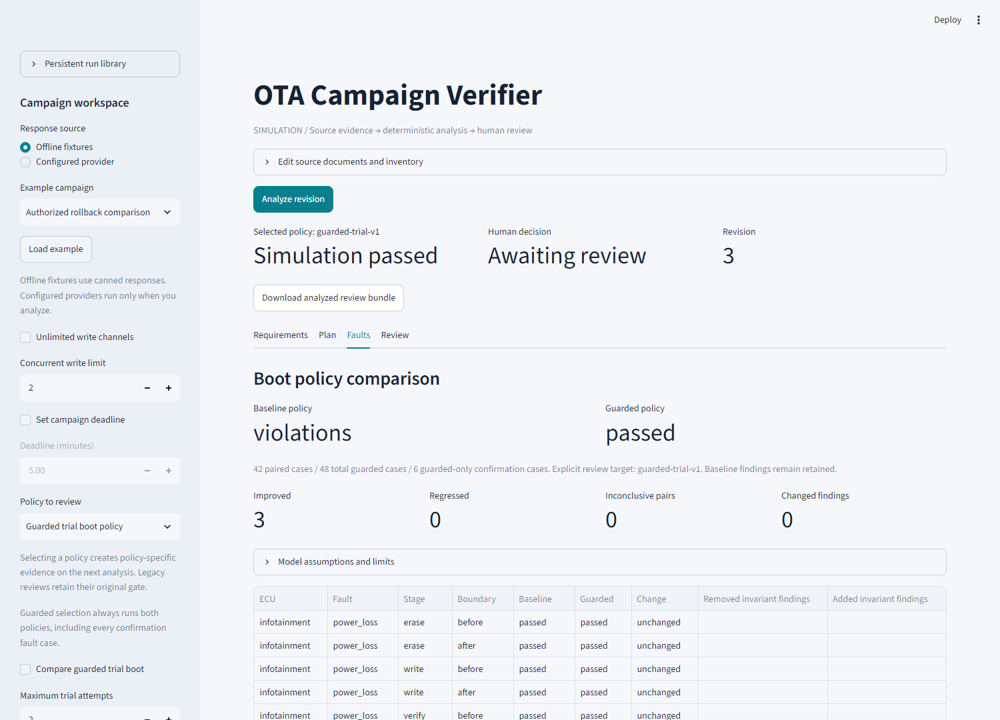

# OTA Campaign Verifier

A **software-defined vehicle OTA campaign simulation** that checks the path to
an update, including intermediate versions and fault recovery.

A campaign can end with compatible versions yet have no compatible activation
order. It can also have a feasible nominal schedule but fail to recover after a
boot fault. This project makes those differences visible before a human reviews
the simulated proposal.

LLMs extract requirements, check extraction faithfulness, and explain evidence.
**Compatibility, parallel planning, fault injection, recovery, and invariants are
deterministic code.** They run and are tested without model services.



*Actual Streamlit UI using scripted synthetic responses. The guarded example
passes its modeled sweep while baseline failures stay visible; human review is
still pending. This is not live-model accuracy, vehicle validation, or
certification evidence.*

[Three-minute demo](docs/demo_walkthrough.md) ? [Screen recording](docs/assets/demo.webm) ?
[Architecture](docs/architecture.md) ? [Release validation](docs/phase11.md)

## Free hosted demo ? deployment pending

[Open Streamlit Community Cloud deployment setup](https://share.streamlit.io/)

The public demo is prepared for repository `sravasti12/OTA-Campaign-Verifier`,
branch `main`, entrypoint **`app/public_demo.py`**, with Python **3.14** and the
root `requirements.txt`. Publish the prepared files through your Git workflow,
then sign in to Community Cloud and deploy. No API keys are needed.

**Live app link:** not available yet. The actual platform-assigned URL will be
added after deployment succeeds; no guessed URL is advertised as a live app.
See the [step-by-step free deployment guide](docs/deploy_free.md).

The public page runs real deterministic analysis on synthetic fixtures. It omits
provider configuration and server-filesystem controls; review records are
session-only simulation records.

## What the demonstrations prove under the model

| Scenario | Measured result | Why it matters |
| --- | --- | --- |
| Parallel update | Six ECU-minutes of writing in four simulated minutes, with every activation compatible | Writes overlap while activation dependencies remain enforced. |
| Intermediate-version trap | Final versions compatible; no feasible activation order; two source-linked conflicting rules | Checking the destination alone misses the problem. |
| Guarded recovery | Baseline violations retained; guarded policy passes 48 cases, including 6 confirmation cases | Policy improvements remain separate from baseline evidence and human approval. |

The frozen reference benchmark matches all 11 labeled deterministic campaigns
and covers 252 core fault cases. Its 12 extraction fixtures yield 8 ready and 4
required-abstention outcomes. These are regression checks using supplied answers,
not measured model performance. See the [recorded local evidence](docs/release-evidence.json).

**Local verification:** 548 tests passed on Windows/Python 3.14.4, with 14
upstream/cache warnings. The JUnit digest and counts are retained in the release
summary.

**Release status:** local evidence and the browser demo are validated. Remote
Windows/Linux CI and real OIDC login/role/logout checks remain pending because
those services are not configured. No public deployment is claimed.

## Setup and tests

Python 3.11+ is required. In PowerShell, from this directory:

```powershell
python -m venv .venv
.\.venv\Scripts\python -m pip install -e ".[dev]"
.\.venv\Scripts\python -m pytest -q
```

The workspace verification uses Python 3.14.4. Python 3.11 has not been exercised
here. After dependency installation, all tests and planning run offline without
LLM services, environment variables, or credentials. `.env.example` documents
optional provider configuration; `.env` is ignored.

Run just the Phase 2 tests:

```powershell
.\.venv\Scripts\python -m pytest -q tests/test_planner.py tests/test_exhaustive_planner.py tests/test_plan_validation.py tests/test_cli.py
```

## Try parallel planning

```powershell
.\.venv\Scripts\python -m ota_verifier.cli examples/parallel_campaign.json --max-parallel 2
```

The demo needs nine total ECU-minutes of writing but finishes in five simulated
minutes: infotainment overlaps the gateway/brake updates. Gateway and brake
share a mutex, and brake activation requires the updated gateway. The result is
JSON containing exact start/end times, activation indices, source constraint
IDs, written slots, and the initial state plus every post-activation state.

Block that campaign with a four-minute deadline:

```powershell
.\.venv\Scripts\python -m ota_verifier.cli examples/parallel_campaign.json --max-parallel 2 --deadline-ms 240000
```

The result identifies the shared-flash-channel requirement and deadline as a
subset-minimal conflict, with the requirement's original document and sentence.
The JSON result is a diagnostic report, not permission to waive requirements.

CLI exit codes are 0 feasible, 2 infeasible, 3 unknown, and 1 invalid input.
Argument syntax errors use argparse's standard exit code 2. Installed packages
also expose the `ota-plan` command. Options include `--timeout-ms` (default 10000),
`--max-parallel`, and `--deadline-ms`. Omitting a concurrency limit assumes
unlimited independent write channels; set a limit to model constrained resources.

## Python API

```python
from pathlib import Path
from ota_verifier.models import Campaign, FeasibleResult, PlanningOptions
from ota_verifier.planner import plan_campaign
from ota_verifier.scheduling import validate_plan

campaign = Campaign.model_validate_json(
    Path("examples/parallel_campaign.json").read_text(encoding="utf-8-sig")
)
result = plan_campaign(campaign, PlanningOptions(max_parallel=2))
if isinstance(result, FeasibleResult):
    assert validate_plan(campaign, result.plan) == ()
    assert result.plan.makespan_ms == 300_000
```

## Phase 2 planning semantics

| Concern | Explicit modeling rule |
| --- | --- |
| Writes | Nonpreemptive writes to inactive A/B slots; old active images keep running. |
| Timing | Integer milliseconds. Each supplied flash duration is rounded upward to a millisecond. |
| Activation | Instantaneous at write completion. Every activation has a unique index. Equal-time activations execute in index order, with compatibility checked after each. |
| Intermediate compatibility | Initial state and every ordered post-activation state must satisfy every applicable dependency. Writes alone do not change active versions. |
| Mutex | No pair in a mutex group may overlap writes. Intervals are half-open: an end may equal another start. |
| Order | The before ECU must finish and activate before the after ECU starts; equal end/start timestamps are permitted with activation first. |
| Environment | Ignition and battery remain at their initial values. Each changed ECU's preconditions must hold; waiting cannot improve the environment. |
| Capacity | At most `max_parallel` writes overlap. No bandwidth sharing, power load, or flash-speed variation is modeled. |
| Deadline | Every write and activation must finish by the supplied deadline. |
| Downgrades | A numerically older target requires authorization matching the exact ECU and numeric destination version. |
| Image validity | All initial active images must be marked valid. Nominal target writes are assumed successful and valid. |
| No-op ECUs | Numerically equal current/target versions need no step but remain in all compatibility checks. Order applies only when both endpoints are updated; mutex and preconditions apply only to scheduled writes. |
| Update repertoire | One direct current-to-target update per changed ECU; no bridge releases, repeated updates, or atomic multi-ECU activation. |

The solver minimizes campaign makespan in the millisecond model. Among optima,
it prefers earlier starts and then lower activation indices in ECU ID order.
Every returned plan is independently replayed through the concrete compatibility
checker and concrete schedule checks. A validation disagreement raises an
internal error instead of returning a successful result.

A hard scheduling horizon equal to the sum of rounded write durations is
sufficient under these fixed-environment rules: any feasible activation order
can be executed sequentially within that horizon. Capacity and mutex constraints
only restrict overlap, and no modeled requirement imposes a minimum wait.

Result types deliberately distinguish:

- `feasible`: a validated schedule. `plan.optimal` reports whether minimum makespan
  was proved. If optimization times out, an already established feasible schedule
  can still be returned with `optimal=false` and an explanatory note.
- `infeasible`: a proved contradiction, with source constraints and/or explicit
  resource/policy assumptions. `conflict.subset_minimal=true` means removing any
  reported group makes that subset satisfiable relative to the fixed transition
  model. This is not a globally smallest conflict set. If shrinking times out,
  the proved core is retained and minimality is marked false.
- `unknown`: no feasibility verdict was established within the solver budget.
  This never means the campaign is impossible.

The budget is shared across feasibility, conflict shrinking, optimization, and
tie-breaking. Ties may remain noncanonical if that budget expires after makespan
optimality is established; the result note reports this separately. Serialization
and concrete replay can take additional time beyond the solver budget.

Plan states project active images and completed activations. They do not record
partially written inactive images or fault traces. A feasible nominal plan does
not establish recovery or fault-tolerance properties. The Phase 3 simulator adds
actual intermediate simulated slot states and fault/recovery evidence without
changing the planner's nominal guarantees.

## Phase 3: fault simulation and invariant checking

Run the same parallel demo through the full bounded single-fault matrix:

```powershell
.\.venv\Scripts\python -m ota_verifier.cli examples/parallel_campaign.json --max-parallel 2 --stress-test
```

The demo executes one nominal run and **42 single-fault runs** (14 for each of
three updated ECUs). It deliberately has no rollback downgrade authorizations.
The nominal run passes; the stress report contains violations for blocked
rollback paths and boot failures. CLI exit code **4** means observed invariant
violations, not a crashed command or failing pytest test. The JSON retains all
traces, exact fault specifications, recovery evidence, and source-linked findings.

Stress mode adds exit code **5** for an inconclusive result. A report with both
violations and inconclusive cases reports violations; individual cases retain
inconclusive status. Normal planning behavior and exit codes are unchanged.
`--max-recovery-states` sets the deterministic recovery-search bound (default
10000). No LLM, credentials, network, or solver calls are required by the simulator
or recovery API; the CLI still uses Z3 first to obtain a nominal plan.

```python
from ota_verifier.simulator import simulate_plan, stress_test
from ota_verifier.simulation_models import FaultSpec, SimulationOptions

# campaign and result.plan are obtained using the planning example above.
nominal = simulate_plan(campaign, result.plan)
faulted = simulate_plan(
    campaign, result.plan,
    FaultSpec(ecu_id="gateway", stage="write", kind="power_loss"),
)
report = stress_test(campaign, result.plan, SimulationOptions(max_recovery_states=10000))
```

The public simulation API rejects invalid plans and unsupported fault boundaries.
It checks the original state, every stage/fault/halt transition, and each executed
recovery action. Findings retain trace indices, invariant names, ECU IDs, and
constraint evidence where applicable. Successful recovery never removes an
invariant violation already observed earlier in the run.

### Explicit flash and fault model

Each ECU executes erase at write start, write at the integer midpoint, then
verify, activate, and boot at its scheduled end. Even one-millisecond writes
erase before writing. Same-time completions execute verify/activate/boot in the
plan's activation order before new writes start. Intermediate slot contents are
represented as target-version images with `valid=false`; verification marks a
successful write valid. The old active image remains selected during writing.

| Injected fault | Boundary and effect |
| --- | --- |
| Power loss | Before and after all five stages: interrupts all in-progress writes, preserves persisted active pointers and already verified images, then stops the campaign. |
| Write corruption | After write: records corruption, continues until verification detects it, and blocks activation. |
| Verification failure | Before verify: the unverified target is not activated. |
| Activation failure | Before activation: the old active pointer is retained and the verified inactive target is preserved. |
| Boot failure | Before boot, after activation: the selected target is marked unbootable. This is an observed bootability violation, even if fallback later repairs it. |

Every failure cancels other in-progress writes and future scheduled events.
The affected inactive images remain invalid. Completed valid writes are not
silently erased. Power-loss recovery assumes power has returned with the same
supplied battery/ignition values; elapsed outage/reboot time is not modeled.
There is no physical byte-level flash, network transfer, battery drain, corrupted
metadata, damaged original slot, or simultaneous multi-fault model. Before/after
stage injection is finite model coverage, not an assertion of all real fault
conditions or continuous-time behavior. `valid` is simulated integrity/bootability
data, not cryptographic or hardware verification.

### Recovery policy and the four invariants

Recovery explicitly targets **the campaign's original active slots and versions**.
A compatible partial-update safe stop does not satisfy this stronger selected
rollback goal. Inactive contents need not match their initial contents.

1. Selected active images must be bootable.
2. Every observed active-version configuration must satisfy `compat.py`.
3. Installing a newly verified older image or activating an older retained image
   needs an authorization for that ECU and numeric destination version.
4. A failed step needs a proven safe, authorized slot-switch path to the original
   active images.

The planner and simulator share the version-change permission policy in
`policy.py`. Existing old inactive images are not newly installed images, and
returning to an original *newer* image after an authorized downgrade is an
upgrade. Returning to an original older image has **no implicit permission**.
Synthetic input may explicitly include, for example:

```json
"downgrade_authorizations": [
  {
    "ecu_id": "gateway",
    "version": "1",
    "authorized_by": "simulation-reviewer",
    "reason": "Explicitly permit restoring this original image in the demo"
  }
]
```

This permission is scoped to the gateway and version 1. It does not authorize
other ECUs or versions, bypass compatibility, or hide boot failures.

`recovery.find_recovery` performs bounded breadth-first search over existing
valid A/B images. Every successor must be fully bootable, compatible, and
version-authorized. It returns a shortest path when available. For example, the
recovery-trap benchmark requires restoring the brake before the gateway; a local
gateway-only fallback is rejected by the same compatibility checker as planning.
No new images are invented, downloaded, repaired, or flashed during recovery.
Recovery switches are logical transitions at the failure timestamp and are not
subject to the nominal flash-duration deadline or mutex write intervals.

Recovery results distinguish a proved unavailable path from a search limit:

- `available`: a replay-validated action sequence and all intermediate states.
- `unavailable`: exhaustive search proved no path under these rules; rejected
  candidates and their blockers are diagnostic evidence, not executed actions.
- `unknown`: the state bound was exhausted; the run is inconclusive unless an
  invariant violation was already observed. Unknown is never presented as proof
  of a missing rollback path or as a pass.

`SimulationResult.status=failed` means the injected fault aborted the campaign.
Its separate `assessment=passed` means the checked invariants held and the chosen
rollback goal was reachable despite that expected abort. Boot-failure injections
intentionally demonstrate the strict bootability invariant being violated in
this model; even fully authorized recovery cannot make those historical cases
pass. A complete nonempty sweep therefore includes those negative cases.
No-op campaigns have a nominal run and zero fault cases, reported explicitly.

Run Phase 3 tests only:

```powershell
.\.venv\Scripts\python -m pytest -q tests/test_invariants.py tests/test_recovery.py tests/test_exhaustive_recovery.py tests/test_simulator.py tests/test_simulation_models.py tests/test_stress_cli.py
```

Phase 3 tests include parallel interruptions, all fault boundaries, retained
slots, delayed corruption detection, blocked/authorized rollback, historical
findings, recovery search limits, report integrity, round-trip serialization,
CLI behavior, and deterministic isolated runs. Sixteen small recovery scenarios
are compared with an independent exhaustive A/B state graph and all-pairs
shortest-path oracle. This checks recovery availability and shortest path length.

## Phase 4: evidence-linked document extraction

Extract constraints from release notes and ECU documentation through one
`llm/client.py` abstraction, then apply strict schema/provenance checks and a
separate faithfulness review. Ambiguous, unsupported, malformed, or unverified
extractions block automatic planning. Inventory, target versions, and downgrade
permissions remain authoritative structured input.

Try a complete offline demo using explicitly labeled canned responses:

```powershell
.\.venv\Scripts\python -m ota_verifier.documents_cli examples/documents/clear-0.case.json --fixture --plan --max-parallel 2
.\.venv\Scripts\python -m ota_verifier.documents_cli examples/documents/ambiguous-4.case.json --fixture --plan
```

The first reaches planning; the second stops with review findings (exit 6).
Fixture responses are not live model evaluations. To exercise ground-truth
metrics and deliberately reveal correlated extraction/reviewer errors:

```powershell
.\.venv\Scripts\python eval/run_eval.py --mode fixtures
.\.venv\Scripts\python eval/run_eval.py --mode fixtures --profile false_approval --fail-on-false-acceptance
```

The second command intentionally exits 4 after detecting unsafe handoffs against
hidden ground truth. Actual live evaluation is opt-in with `--mode live` and
requires `.env`/environment configuration. Set `LLM_PROVIDER` to `ollama`, `gemini`,
or `groq`, and configure an actual `LLM_MODEL`. No keys or live services are needed
for the test suite. The verifier can use `LLM_VERIFIER_MODEL` if configured.

Run records retain exact documents and character spans, hashes, prompts and
versions, provider/model identity, raw responses, validated constraints, and
review findings. API keys and HTTP headers are excluded. The deterministic core
continues to run without any LLM calls.

See [the Phase 4 guide](docs/phase4.md) for provider configuration, evidence
semantics, evaluation definitions, saved-run validation, and explicit limits.

## Phase 5: local review workspace

Launch the Streamlit app after installing `.[dev]`:

```powershell
.\.venv\Scripts\python -m streamlit run app/streamlit_app.py
```

Open `http://localhost:8501`. Offline fixtures are selected by default; click
**Analyze revision** to run the checkpointed workflow without credentials.
The screen shows source evidence, a parallel flash timeline, activation states,
fault traces, recovery paths, advisory explanations, and human review.

LangGraph pauses before the human-review node using `MemorySaver` and
`interrupt_before`. Review decisions bind to an exact run/revision/snapshot hash.
Changes require reanalysis and invalidate the prior active decision; history
remains available. Rerenders and repeated review submissions do not repeat
completed analysis or model calls. Download a JSON review bundle to retain all
source, analysis, explanation, and decision evidence.

A feasible plan can still have stress violations. **Review with findings** does
not turn violations into a pass, and approval is unavailable for blocked,
infeasible, unknown, or failing analysis. The **No updates (approval demo)**
example explicitly has zero update/fault steps; it demonstrates review plumbing,
not fault tolerance of a nonempty campaign.

Configured-provider mode runs only on explicit analysis submission and uses the
same provider abstraction, with optional `LLM_EXPLAINER_MODEL`. Explanation errors
fall back to deterministic summaries. No vehicle execution or deployment exists.
The default memory checkpoints live only in the current process/browser session.
Phase 7 adds an optional SQLite workspace for restart recovery; JSON exports
remain evidence downloads rather than executable checkpoint imports.

See [the Phase 5 guide](docs/phase5.md) for the state graph, exact review policy,
headless API, explanation limits, and test commands.

## Phase 6: compare boot policies

In the local app, load **Authorized rollback comparison**, enable **Compare
guarded trial boot**, then click **Analyze revision**. The **Faults** view pairs
baseline and guarded traces, shows image integrity separately from boot health,
and displays confirmed slots, trial candidates, and actual availability.

The example has explicit synthetic rollback permissions. It compares **42 shared
fault cases** and adds **6 guarded-only confirmation cases**. Three boot-failure
outcomes improve: the unchanged baseline retains violations while the guarded
policy passes its complete 48-case sweep under the stated assumptions. Missing
permissions, incompatible fallback, and availability cycles still produce blocked
recovery or violations; search limits remain inconclusive.

For a headless comparison:

```powershell
.\.venv\Scripts\python -m ota_verifier.cli examples/authorized_boot_campaign.json --compare-boot-policies --max-parallel 2
```

Exit 4 is expected because the baseline still has violations. Comparison results
never overwrite the legacy baseline review gate. Phase 9 separately allows an
explicitly selected guarded policy in a new versioned workflow revision. Options
and complete comparison evidence are bound to the review snapshot; changes
require a new revision.

A candidate becomes effective only after a successful health check. Rejecting a
never-effective candidate retains the old version; returning to an older image
after successful exposure still needs explicit authorization. Confirmation is
modeled as atomic durable metadata, and rebooting ECUs are explicitly unavailable.
Durability here concerns simulated power loss, not Python-process persistence.

See [the Phase 6 guide](docs/phase6.md) for exact semantics, coverage, the negative
cold-start example, APIs, and verification evidence.

## Domain and compatibility contract

ECU configuration and runtime state are separate: `ECU` holds current/target
versions and flash duration; `ECUState` holds A/B images and active slot.
Constraints retain stable IDs, source document IDs, and source sentences.
Pydantic rejects unknown fields, malformed specifications, unknown ECU references,
duplicate IDs, invalid active slots, incomplete initial state, and contradictory
current-version observations.

One definition in `compat.py` expresses dependency implication for both concrete
and symbolic evaluation. `check_compatibility` returns all violated `requires`
constraints with source evidence, actual dependency version, and expected spec.
Only active images participate. Missing or extra runtime ECUs raise an input
error rather than being treated as compatible.

Compatibility alone does not imply bootability, valid environment, allowed
ordering, or authorization. Invalid active images and incompatible initial
states remain representable as input for analysis; the planner blocks them.
An active slot must contain an image. Unbootability is represented with
`valid=false`, which is supplied simulation data, not verified cryptographic
image integrity.

Versions are dotted nonnegative numeric components: `4.10 > 4.2`, `4.2.0 == 4.2`,
and leading zeros are insignificant. Each specification has one explicit `==`,
`!=`, `>=`, `<=`, `>`, or `<` comparison. Prereleases, build metadata, compound
ranges, prefixes, and whitespace are rejected.

Strict Python construction uses tuples; JSON arrays are accepted through
`model_validate_json`. Records are frozen and `model_dump_json` preserves source
evidence. Create states with validated constructors rather than unchecked
`model_construct` or `model_copy(update=...)` APIs. `validate_plan` checks nominal
validity, not a caller-supplied claim of optimality.

## Verification evidence

Phase 1's 69 regression tests remain included. Phase 2 tests cover parallel
speedup, capacity, mutex groups, order, environment boundaries, downgrades,
unchanged ECUs, invalid active images, endpoint and intermediate incompatibility,
conflict evidence and subset minimality, result serialization, altered-plan
rejection, CLI behavior, and interrupted solver operations.

Twenty-four reproducible tiny campaigns are checked against exhaustive
start-time and activation-order enumeration, comparing both feasibility and
optimal duration. These cases use integer-minute durations and deadlines; for
a fixed ordering their integer difference bounds admit a lattice optimum.
This provides an independent scheduling oracle for those cases, not an
exhaustive validation of arbitrary campaign sizes or real systems.

The five hand-authored benchmarks in `tests/fixtures` remain:

| Fixture | Expected result |
| --- | --- |
| `compatible.json` | Compatible initial, intermediate, and target states. |
| `order_sensitive.json` | Gateway activation first works; brake activation first violates its dependency. Writes can still overlap. |
| `impossible_direct.json` | Compatible endpoints, but either first single-ECU activation fails. Parallel writes do not resolve this. |
| `recovery_trap.json` | Reverting the gateway alone breaks the updated brake dependency. |
| `invalid_input.json` | Validation rejects an unknown dependency ECU. |

## Later phases

The scoped simulation workflow is implemented through local human review.
Compatibility, planning, fault injection, and invariant checking remain entirely
deterministic; LLM use stays limited to extraction, verification, and explanation.
Potential later work includes durable checkpoint storage, authenticated review,
and broader benchmark coverage. Those are not guarantees of this local demo.


## Phase 7: persistent runs and review history

In the Streamlit sidebar, open **Persistent run library** and then **Open SQLite
workspace** to save future analyses in `.ota_state/reviews.sqlite`. Reopen saved
runs after a restart, explicitly resume incomplete analysis, and inspect prior
revisions and implementation versions. Default sessions still use memory.

Completed model outputs are reused; uncertain requests require an explicit new
revision. Decisions bind to the current evidence hash and are committed
transactionally. Reviewer identities remain self-reported in this local tool.

See [Phase 7 usage and recovery rules](docs/phase7.md). Phase 7 completes the
current local portfolio milestone. [The next-phase roadmap](docs/roadmap.md)
records completed evaluation/reproducibility and explicit policy selection.
The single-host shared-review and operational-hardening phase is now implemented;
no further numbered phases are planned.


## Phase 8: reproducible benchmark evidence

Run the frozen deterministic and reference-fixture benchmark:

```powershell
.\.venv\Scripts\python -m ota_verifier.benchmark.runner --mode fixtures --split all --fail-on-findings --output runs/my-benchmark.json
```

The corpus contains 11 deterministic campaigns and 12 extraction cases with
separate development and held-out wording. Reports include per-type semantic
precision/recall, exact citation metrics, schema rejection, faithfulness false
acceptance, latency, provider configuration, and version fingerprints. Fixture
scores are scripted harness checks, not live-model accuracy. Use `--mode core`
for the deterministic benchmark alone; live evaluation requires explicit
`--mode live` and configured credentials.

See [Phase 8 methodology and commands](docs/phase8.md) and the recorded
[reference baseline](eval/baseline_v1.json). Offline CI is configured for
Python 3.11?3.14 on Windows and Linux; only Windows/Python 3.14 has been verified
locally. Correctly detecting an expected campaign violation counts as a passing
benchmark check, never approval of that campaign.


## Phase 9: choose the policy under review

In the Streamlit sidebar, select **Policy to review** before analyzing. Choose
**Baseline policy** or **Guarded trial boot policy** to create policy-specific
`workflow-v2` / `review-bundle-v2` evidence. **Legacy baseline review** retains
the earlier gate and export schema.

For **Authorized rollback comparison**, selecting guarded trial boot produces a
passing guarded assessment while retaining all baseline violations. Only an
explicit human decision can approve that selected simulation proposal. Switching
policy or changing trial options requires a new revision and invalidates the
prior decision's applicability. Missing permissions, regressions, unknowns, and
incomplete selected-policy coverage still block approval.

See [Phase 9 review rules and API](docs/phase9.md). Optional shared review and
operational controls are described in Phase 10 below.


## Phase 10: optional shared review and operational controls

Local mode remains the default offline demo. Optional single-host shared mode
uses Streamlit OIDC login and an operator-controlled issuer/subject allowlist.
Reader, analyst, reviewer, and admin roles are enforced at the service boundary;
reviewer identity and provenance commit atomically with the human decision.
Shared mode requires a deliberate schema migration and protected configuration.

Verified SQLite backup/restore includes WAL commits, revisions, review history,
authentication metadata, and checkpoints. Reviewed runs can be archived read-only
without deleting evidence. Portable exports have content identifiers; authenticated
exports retain provenance separately from historical self-reported identities.

Follow [Phase 10 setup, maintenance commands, and limits](docs/phase10.md).
Login and UI authorization are tested with mocked verified identities; an actual
identity-provider login and network deployment have not been exercised. The
checked-in server stays on loopback. No further numbered phases are planned.


## Phase 11: release validation and portfolio evidence

Generate a new offline release evidence pack:

```powershell
.\.venv\Scripts\python -m ota_verifier.release_validation --output runs/my-release
```

It contains the three demo review bundles, the fixture benchmark, verified
migration/backup/restore artifacts, receipt-reuse checks, and an artifact hash
index. Proposals remain awaiting human review. External CI and live OIDC gates
remain explicitly pending, as agreed for this milestone.

[Phase 11](docs/phase11.md) documents verification, remaining setup, and release
criteria. [Architecture](docs/architecture.md) explains the model boundaries;
[the demo walkthrough](docs/demo_walkthrough.md) includes the presentation script
and instructions for regenerating the real browser screenshots and recording.
