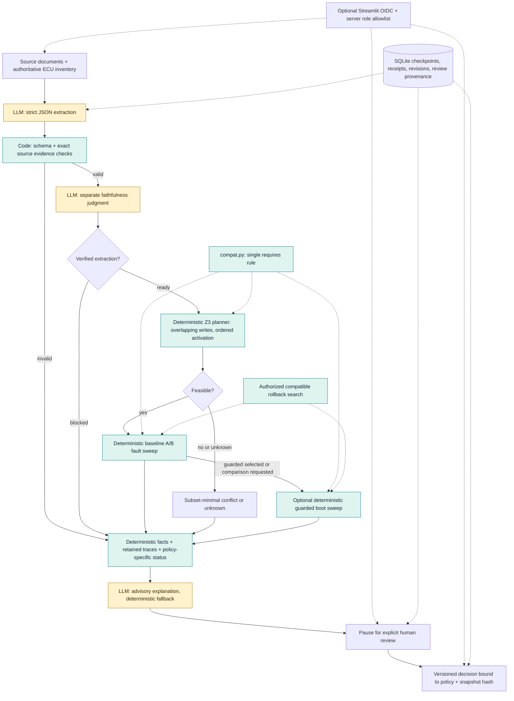

# Architecture and decision boundaries

OTA Campaign Verifier is a software-defined vehicle update **simulation**. It
models campaign scheduling and fault/recovery behavior; it has no vehicle adapter.

Only the three yellow stages can call a model. Compatibility, planning, fault
injection, recovery, and invariant checks use deterministic code. The planner and
invariants use the same compatibility rule for every relevant intermediate state.
A second model judgment is evidence, not proof; correlated extraction errors are
measured by the benchmark's deliberately incorrect fixture profiles.

Nominal compatibility and fault tolerance are separate. A feasible parallel plan
can still fail boot or rollback invariants. Baseline and guarded reports retain
separate assessments; an explicit policy-specific revision determines what a
human decision covers. Advisory explanations cannot select a policy, alter
permissions, or approve a campaign.

SQLite is an optional trusted single-host workspace. Responses are journaled
before graph checkpoint completion; committed outputs can be reused, while
uncertain remote requests require an explicit new revision. SQL decisions are
authoritative if a process dies before its graph checkpoint catches up. Backups
capture WAL commits and are verified before restore to a new path.

Shared browser review uses authenticated issuer/subject identities and server
roles. Host operators owning source/database files remain trusted. Local mode
records reviewer names as entered. Neither hashes nor OIDC provenance constitute
a signed or tamper-resistant audit log.
