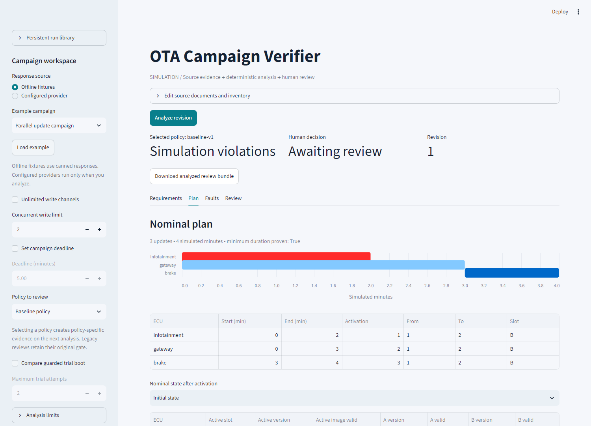
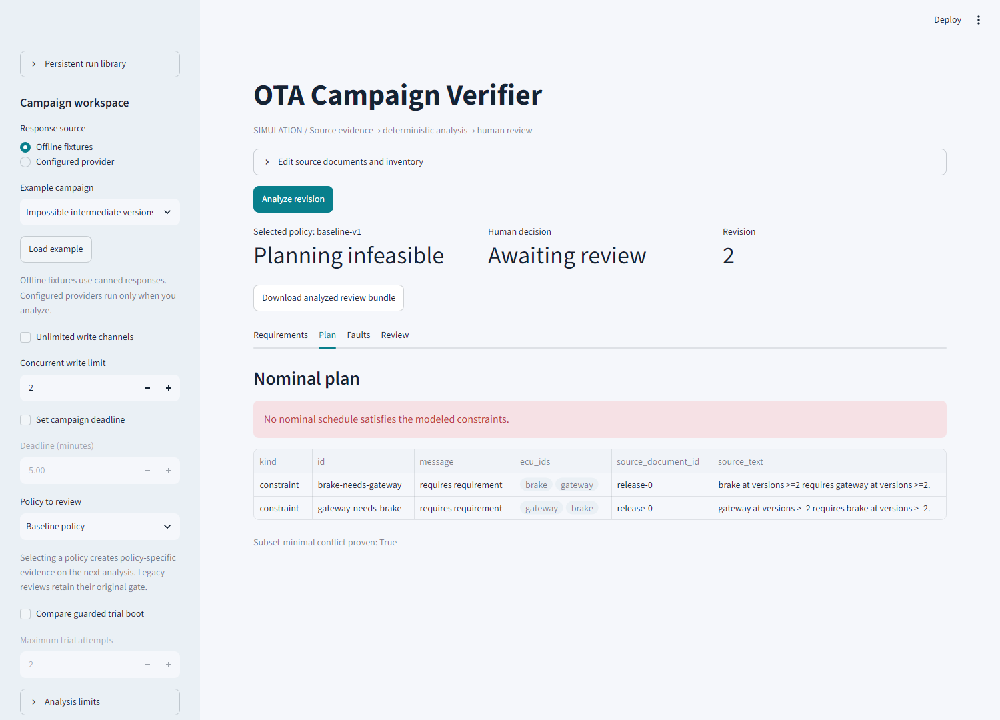
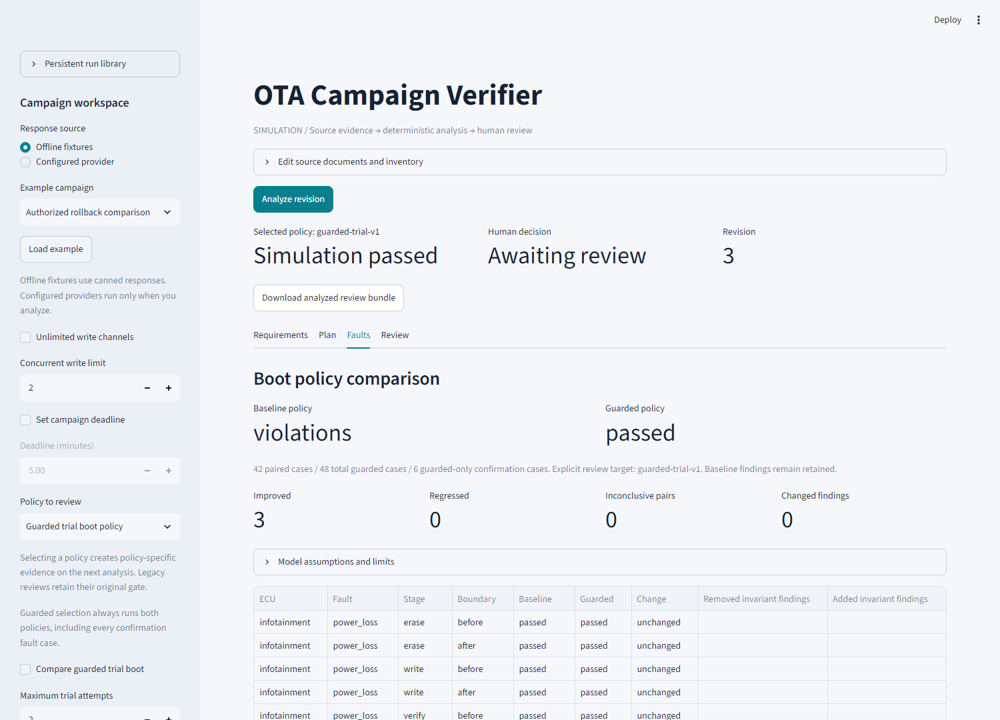
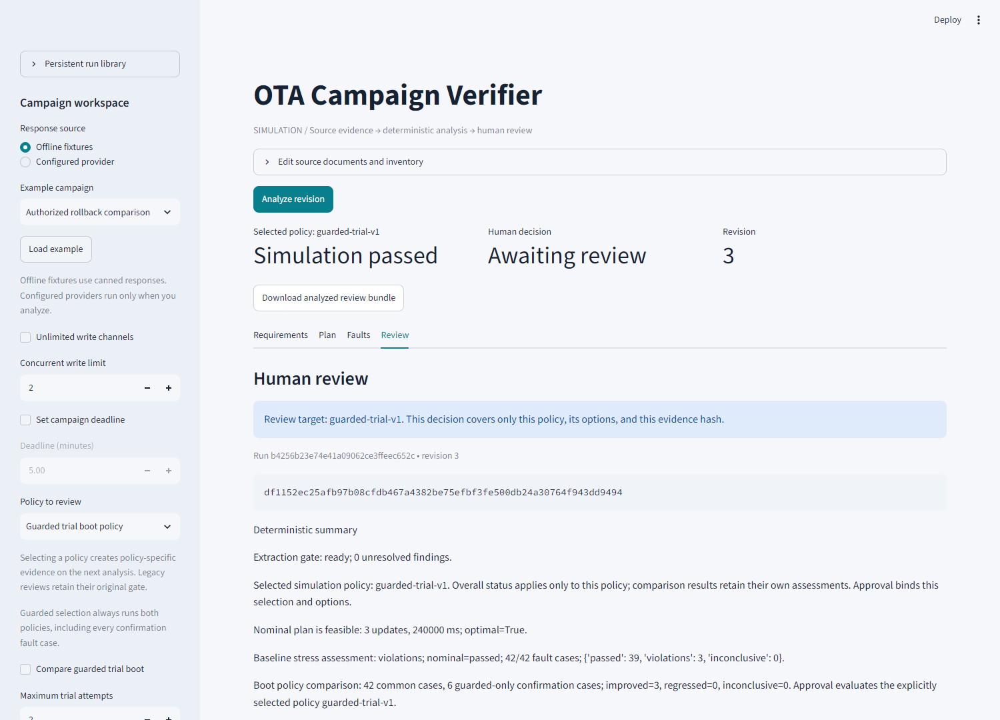

# Phase 11: release validation and portfolio presentation

This milestone turns the implemented simulation into inspectable demonstration
and release evidence. It does not add a new planning/fault model or claim a live
vehicle, production deployment, or certification result.

The agreed scope completes local validation and presentation. GitHub CI and a
live identity provider are not configured; the user explicitly chose to document
setup and keep those external release checks pending.

## Delivered artifacts

* A release evidence builder, `python -m ota_verifier.release_validation`, that
  writes only to a new directory and checks three complete fixture workflows.
* An operational rehearsal: explicit schema migration, pause after extraction,
  service restart, reuse of saved responses, complete guarded analysis, live-WAL
  backup, restore into a new path, and equality of exported evidence.
* A source/decision-boundary [architecture diagram](architecture.md) and a
  [three-minute demonstration script](demo_walkthrough.md).
* Four actual Streamlit browser screenshots, a silent WebM recording, and a
  [capture manifest](assets/capture-manifest.json) identifying synthetic inputs
  and hashing the media files. No human decision was recorded in the capture.
* A portfolio-oriented README and [tracked local release summary](release-evidence.json).
* CI steps to save JUnit output and run the release rehearsal on each configured
  Python/OS job, alongside the existing frozen benchmark and environment export.

## Measured local results

| Check | Result |
| --- | --- |
| Full local pytest suite | 548 passed, 0 failures, 0 errors, 14 warnings (13 upstream deprecations and 1 cache-directory warning); JUnit saved locally |
| Parallel demonstration | 360,000 ms of total writing, 240,000 ms campaign duration; overlapping writes and every activation compatible |
| Intermediate-version trap | Final versions compatible; infeasible ordered activation; subset-minimal conflict contains both dependency rules |
| Guarded demonstration | 42 paired baseline cases retain violations; all 48 guarded cases pass, including 6 confirmation cases; 3 improvements and 0 regressions in this example |
| Benchmark | All 11 deterministic labels/oracle checks pass; 252 core injected cases; 12 extraction fixtures across both wording splits |
| Saved responses | Extraction and verification receipt payloads unchanged after restart; exactly one explanation receipt added |
| Restored evidence | Complete exported evidence equal to the pre-backup export; schema 2 retained; no decision created |
| Browser capture | Real Chromium interaction with synthetic fixtures; charts rendered; no JavaScript page errors; human review still pending |

These measurements describe only the frozen synthetic examples and the current
simulation assumptions. Fixture precision/recall is a harness check using canned
answers. It is not evidence of an LLM's accuracy on unseen ECU documents. A
successful benchmark detects expected violations; it does not approve campaigns.
The guarded policy still requires explicit rollback permissions and can regress
on availability cycles, as covered elsewhere in the test corpus.

## Run the release checks

From `ota_verifier`:

```powershell
.\.venv\Scripts\python -m pytest -q --junitxml=runs/my-pytest.xml
.\.venv\Scripts\python -m ota_verifier.release_validation --output runs/my-release
```

The release directory contains:

| Artifact | Purpose |
| --- | --- |
| `release-validation.json` | Local check results, runtime versions, source fingerprint, and explicitly pending external gates |
| `benchmark.json` | Full frozen fixture benchmark, raw call evidence, metrics, and timings |
| `parallel.json` | Full source/extraction/plan/fault/review snapshot for the parallel example |
| `intermediate_conflict.json` | Full evidence for the source-linked dependency conflict |
| `guarded_recovery.json` | Full baseline and guarded reports in policy-specific review evidence |
| `recovery/` | Fresh source, pre-migration backup, verified final backup/manifest, restored database, and exported review |
| `artifact-index.json` | SHA256 hashes of the generated files, excluding the index itself |

The builder never generates approval. All proposals remain awaiting human review.
A zero exit status means the **local checks** passed, not that a release is fully
validated. `release_ready` remains false while the external gates are pending.
The report explicitly does not claim pytest was run by the builder: pytest's
separate JUnit output is the evidence for that check. Timings, run timestamps,
and SQLite files may differ across reruns; the benchmark includes a separate
semantic digest. Neither hashes nor the artifact index is a signature.

Six added pytest checks cover demo outcomes, required human review, pending gates,
artifact integrity, response reuse/restore equality, refusal to overwrite, CLI
failure reporting, and prohibition of live provider calls during pack generation.
The browser automation is exercised directly rather than represented as a mocked
screenshot test. It owns and stops its dedicated headless server; it does not
reuse or terminate an existing user workspace/server.

## Screenshots and recording

All images below are genuine captures of this app using **Offline fixtures**.
No diagram or screenshot was generated to imitate a successful UI result.

### Parallel plan



### Intermediate conflict



### Guarded recovery comparison



### Human review



[Download or play the silent browser recording](assets/demo.webm). It demonstrates
all three workflows and stops at review. The [walkthrough](demo_walkthrough.md)
provides a timed narration and the exact commands for regenerating media with
optional Playwright/Chromium dependencies.

## Pending external gate 1: GitHub CI

This workspace is not itself the root of a configured project Git repository;
GitHub CLI is unavailable. No remote job was triggered and no CI badge/result was
invented. The checked-in workflow configures eight jobs: Windows and Linux,
Python 3.11–3.14. Only Windows/Python 3.14.4 has been exercised locally.

To validate it:

1. Create/use a dedicated Git repository rooted at `OTACampaignVerifier`, containing
   `.github/workflows/ci.yml` and the `ota_verifier/` project folder. Do not publish
   an unrelated parent Desktop repository or include secrets, `.venv`, or `runs`.
2. Configure its intended GitHub remote and push the reviewed source. No push,
   repository creation, or publication was performed during this local phase.
3. Run **Offline simulation verification** from GitHub Actions or its push/PR
   trigger. Check every matrix job, not only a single operating system.
4. Retain the workflow URL/commit and download all eight artifacts. Each should
   contain JUnit results, benchmark output, release rehearsal output, and the
   installed dependency environment. Investigate failures rather than weakening
   expected invariant outcomes or removing tests.
5. Record actual job results in release notes. Leave the gate pending until that
   evidence exists; configuration alone is not a passing CI run.

## Pending external gate 2: actual OIDC login/roles/logout

No `.streamlit/secrets.toml` or shared access environment is configured here. The
existing access tests mock Streamlit-verified claims; they do not exercise a real
identity-provider redirect, callback, browser cookie, or provider logout.

Follow [Phase 10 setup](phase10.md), keeping all client/cookie secrets in the
ignored secrets file and all allowlist grants in the protected server config.
Never paste those secrets into release reports, chat, screenshots, or Git.

After configuring a provider, record the actual result of each check:

| Check | Required observation | Current state |
| --- | --- | --- |
| Anonymous browser | Only login screen; no source documents or saved run library | Pending live run |
| Allowlisted reader | Can read/export; cannot analyze/revise or record a decision | Pending live run |
| Analyst | Can analyze; cannot approve without reviewer/admin grant | Pending live run |
| Reviewer | Can decide on eligible exact evidence; cannot analyze without analyst/admin grant | Pending live run |
| Unknown account | Denied even after successful provider authentication | Pending live run |
| Revocation | Disabling/removing the account blocks its existing session's next operation | Pending live run |
| Expired identity | Further operations denied until fresh sign-in | Pending live run |
| Logout | Browser returns to unauthenticated state and cannot read evidence | Pending live run |
| Decision provenance | Stored/exported issuer/subject matches the actual reviewer, not typed form input | Pending live run |

Use synthetic campaigns and non-sensitive account identifiers for a recording.
Provider logout/session behavior must be measured, not assumed. Rehearse backup
before migration/cutover and keep the server on loopback unless a separately
reviewed network deployment is intended. This phase makes no network deployment
or production-security claim.

## Exit criteria

The agreed local Phase 11 work is complete when the full suite, offline release
checks, real browser walkthrough, media review, and documentation are verified.
A public release-validation claim additionally needs recorded passing matrix
results and actual OIDC checks. Those remain pending by explicit user choice;
no further implementation phase is required merely to acknowledge the gap.
