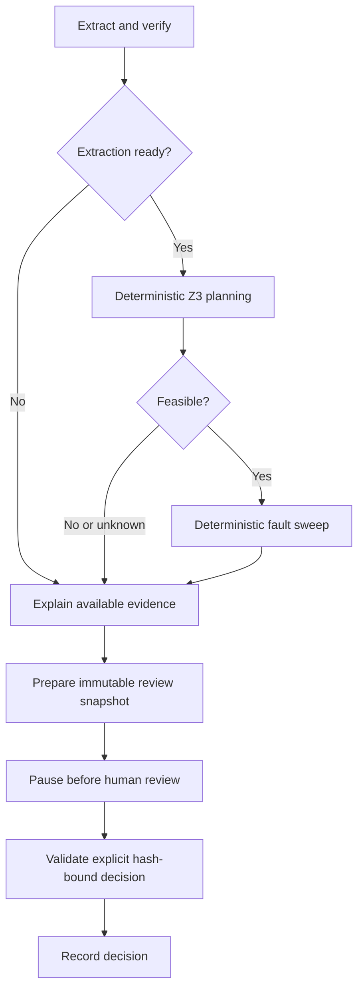

# Phase 5: checkpointed human review

The local review workspace joins document extraction, deterministic planning,
fault simulation, advisory explanation, and explicit human decisions. It remains
an OTA simulation. There is no vehicle connection, deployment operation, or real
campaign execution endpoint.

## Run the review app

From this project directory:

```powershell
.\.venv\Scripts\python -m pip install -e ".[dev]"
.\.venv\Scripts\python -m streamlit run app/streamlit_app.py
```

Open `http://localhost:8501` in your browser. The tracked Streamlit configuration
binds the server to loopback, uses a light teal/slate theme, disables usage
statistics, and avoids automatically opening a browser window.

The default mode is **Offline fixtures**. Click **Analyze revision** to process
the supplied source-only JSON with canned extraction/review/explanation responses.
No credentials or network are required. These responses demonstrate workflow
behavior, not live-model quality. **Configured provider** uses the Phase 4 `.env`
settings and optional `LLM_EXPLAINER_MODEL`, only after an explicit analysis click.
Changing an input or switching tabs never automatically makes a model request.
Workflow invocations disable ambient external tracing, even if tracing is enabled
elsewhere in the shell. Client objects and API headers never enter checkpoints.

Use **Load example** to replace the draft with a selected example:

| Example | Expected result |
| --- | --- |
| Parallel update campaign | Feasible nominal schedule, followed by simulation violations. |
| Dependency-only campaign | Parallel writes with dependency-ordered activation; fault findings remain visible. |
| Conflicting flash order | Z3 infeasibility with a source-linked conflict. |
| Impossible intermediate versions | Compatible endpoints but no permitted activation sequence. |
| Ambiguous requirement | Extraction blocked; no planning or simulation. |
| Unsupported requirement | Extraction blocked; no planning or simulation. |
| No updates (approval demo) | Zero update steps and zero fault cases; passing simulation-proposal review. |

The last example demonstrates approval plumbing only. It does not demonstrate
fault tolerance for a nonempty update campaign. Under the existing strict model,
boot-failure injections produce historical violations for every nonempty fault
sweep, even when recovery succeeds. Human review cannot waive or erase them.

## Four review views

- **Requirements:** extracted constraint IDs, source document IDs, exact quotes,
  character spans, source documents, and gate/reviewer findings.
- **Plan:** parallel write timeline, durations, slot/version transitions, and
  nominal active-version states after each ordered activation. Infeasible and
  unknown planning results have their own displays.
- **Faults:** select an injected fault and inspect its assessment, each trace
  event, A/B image validity, active versions, concurrent writes, invariant
  findings, recovery path, and rejected recovery candidates.
- **Review:** deterministic summaries, evidence-linked advisory explanation,
  the exact snapshot hash, decision controls, and immutable decision history.

Download the **analyzed review bundle** to retain source documents, extraction
and verifier records, constraints, plan, all fault traces and findings, recovery
results, explanation evidence, analysis assumptions/options, and human decisions.
An export always describes the displayed analyzed revision, not unanalyzed edits.

## Graph and stopping behavior

`graph.py` uses `StateGraph`, named nodes, ordinary and conditional edges, a
`MemorySaver` checkpointer, and `interrupt_before=['human_review']`.



The diagram shows baseline-only mode. Phase 6 optionally adds a deterministic
boot-policy comparison node between simulation and explanation; its results are
part of the reviewed snapshot.

A static breakpoint is not the authorization policy. Both the service and review
node validate an explicit decision, its run/revision/snapshot binding, and
approval eligibility. Blindly invoking the paused review node without a decision
raises an error. `WorkflowService.resume` reads the paused/completed run without
making an implicit decision or rerunning completed analysis.

Unique run IDs and revision-specific thread IDs isolate checkpoints. Each new
revision gets fresh clients and a new analysis thread; all prior decisions remain
historical. Within a process, per-run locks serialize competing review/revision
requests, and idempotency keys make repeated identical submissions harmless.
Reusing a key for a different decision, submitting a stale revision, or crossing
run IDs is rejected. Workflow planning is serialized across sessions because the
existing planner uses Z3's shared default context; solver semantics are unchanged.

Checkpointing is **process-local memory**, as originally scoped. It supports
pause/resume while the service/browser session lives, not recovery after a
process restart or browser-session loss. JSON exports are read-only evidence,
not executable checkpoint restoration. There is no database, authenticated
reviewer identity, signed approval, or cross-process locking in this phase.

## Three separate result dimensions

1. **Extraction:** ready or blocked.
2. **Analysis:** planning infeasible/unknown, or simulation passed/violations/
   inconclusive after a feasible nominal plan.
3. **Human decision:** awaiting review, approved, rejected, reviewed with findings,
   or a previous decision invalidated by changed analysis.

A nominally feasible plan is not labeled fault-tolerant. Per-fault uncertainty is
retained even when other observed violations dominate the overall stress verdict.

**Approve simulation proposal** is available only for complete passing analysis.
Blocked extraction, planning infeasibility/unknown, invariant violations, and
inconclusive analysis cannot be approved. **Review with findings** and **Reject
proposal** record human decisions without changing any deterministic result.
Reviewer name and reason are recorded as entered; they are not authentication.
Review text cannot grant or modify downgrade authorizations.

The snapshot hash covers the run identity and revision, source/inventory input,
permissions, extraction and verification evidence, complete planning and
simulation artifacts, resource/deadline/search options, evidence catalog,
advisory explanation, and workflow rules version. Old decisions do not cover
new snapshots. UI draft edits disable review immediately; submitting analysis
creates a new revision and invalidates the old active decision while preserving
history. Hashes detect changes, not malicious forgery or signer identity.

## Advisory explanation boundary

`llm/explainer.py` uses the existing provider abstraction with purpose
`explanation`. The explanation receives a bounded catalog of deterministic facts,
not authority to plan, grant permissions, alter results, or approve the proposal.

Each statement must cite a supplied evidence ID and preserve that fact's typed
outcome. The overall status must match analysis, and required stage summaries
must be covered. The catalog includes source sentences, constraint IDs, plan
steps, conflicts, fault-case indices, and exact trace indices for findings.
Invalid citations, changed outcomes, missing summaries, malformed/truncated
responses, provider failures, and unsupported deployment/certification claims
fall back to deterministic summaries. Rejected prose is not rendered as an
accepted explanation; available raw response evidence remains in the bundle.

Citation and field validation cannot prove every sentence of advisory prose.
Authoritative summaries, facts, and actual simulation results remain separate
and visible, and a human can inspect the evidence before making a decision.
The explanation never determines approval eligibility or invariant outcomes.

## Headless API example

```python
from ota_verifier.graph import WorkflowService
from ota_verifier.workflow_examples import example_input, fixture_dependencies
from ota_verifier.workflow_models import ReviewSubmission, WorkflowInput

request, case = example_input("clear")
service = WorkflowService()
bundle = service.start(WorkflowInput(request=request), fixture_dependencies(case))
assert bundle.review_state == "awaiting_review"
assert bundle.snapshot.artifacts.status == "simulation_violations"

submission = ReviewSubmission(
    idempotency_key="review-1",
    run_id=bundle.run_id,
    revision=bundle.revision,
    snapshot_hash=bundle.snapshot_hash,
    action="review_with_findings",
    reviewer="portfolio-reviewer",
    reason="Reviewed the bootability and rollback findings",
)
reviewed = service.review(submission)
assert service.review(submission) == reviewed  # no duplicate record or model calls
assert reviewed.snapshot.artifacts.simulation.assessment == "violations"
```

## Verification

```powershell
.\.venv\Scripts\python -m pytest -q
.\.venv\Scripts\python -m pytest -q tests/test_graph.py tests/test_explainer.py tests/test_review_app.py
```

Workflow tests cover conditional routing, actual static interruption/resumption,
unchanged results after review, rejected blind approval, stale revisions,
cross-run submissions, idempotent and concurrent duplicate submissions, input/
permission/option hash binding, explicit search uncertainty, tracing isolation,
export round trips, and process-local memory limits. Explanation tests inject
unknown citations, altered outcomes, omitted summaries, malformed output, and
provider outages. Real Streamlit `AppTest` tests exercise source edits, UI
rerenders, blocked cases, decision submission, and invalidation after revision.

All providers are mocked or replaced with clearly labeled fixture responses.
Tests do not measure live-model quality. The UI is verified through Streamlit's
script/widget test harness; no automated visual browser inspection is claimed.

Implementation references: [LangGraph compile/breakpoints](https://reference.langchain.com/python/langgraph/graph/state/StateGraph/compile),
[Streamlit AppTest](https://docs.streamlit.io/develop/api-reference/app-testing/st.testing.v1.apptest).
